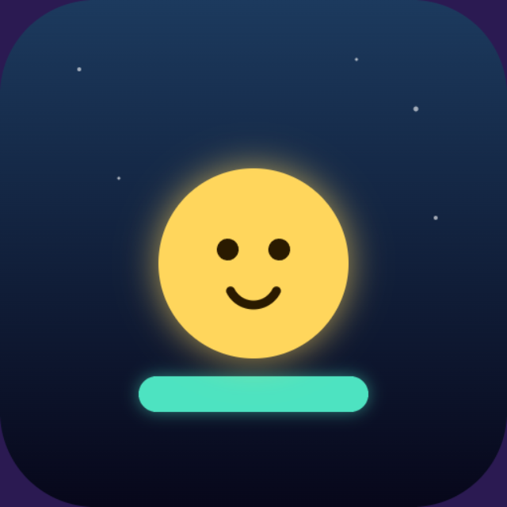

# BOUNCEMOJI



A tiny bitmoji-faced endless climber, built as a Snapchat Web Lens.

## Play

Drag to steer left and right — your bouncer auto-bounces off every platform below it and
climbs higher automatically. Wrap around the screen edges. Normal platforms are safe forever;
cracked ones break after one bounce. Miss a platform and fall off the bottom and it's over.

## Local run

```bash
npm install
npm start        # builds to dist/ and serves it, prints the local URL
```

## Snapchat Lens packaging

```bash
npm run build
npm run lens -- 1   # -> bouncemoji-lens-v1.zip, checked against Snap's Web Lens requirements
```

## Testing

```bash
npm test
```

## Architecture

- `src/game/` — pure game logic: `state.ts` (board constants, procedural platform generation
  with width shrinking and a score-scaling break chance, `GameState`), `physics.ts` (screen-wrap
  and platform-landing detection), `loop.ts` (`step(state, input, dt, hooks)` — gravity, bounce,
  scroll-the-world camera, platform spawn/cull), `input.ts` (direct finger-follow steering with
  tap detection for start/retry).
- `src/render/draw.ts` — all Canvas 2D drawing: an altitude-shifting gradient sky, a parallax
  starfield, bitmoji-faced platforms (cracked ones show a worried face and crack lines), a
  squash-and-stretch bounce animation on the player, and the Bitmoji avatar badge on the title
  screen.
- `src/audio/sound.ts` — procedural Web Audio sound effects and an ambient pad, no audio files.
- `src/snap/profile.ts` — Snapchat leaderboard + Bitmoji + storage, with a `localStorage`
  fallback outside Snapchat.
- `src/main.ts` — the only file touching the DOM: canvas fit, pointer events, the game loop.

No image or audio assets beyond `assets/icon.png` (the Lens Icon upload) — everything else is
drawn or synthesized in code.
